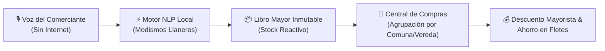

# NexoLlano 🌾📲

> **Inventario por voz sin internet y central de compras colectiva para las MiPymes de Casanare**  
> Proyecto desarrollado por el equipo **NexoTECH** para la convocatoria de innovación abierta **CREATIC Casanare**  
> *Gobernación de Casanare – Dirección TIC / EON CASANARE S.A.S.*


---

## 🎯 1. El Problema en el Comercio Casanareño

En municipios y zonas rurales de Casanare (Yopal, Aguazul, Villanueva, Tauramena, Maní, etc.), la mayoría de tenderos, dueños de ferreterías, agroinsumos y pequeños restaurantes llevan sus cuentas "en la cabeza o en un cuaderno" y compran mercancía de manera solitaria.

Esto genera tres pérdidas críticas diarias:
1. **Productos perdidos o agotados sin saberlo:** Falta de trazabilidad y desabastecimiento imprevisto.
2. **Precios altos de compra y fletes individuales:** Al negociar en bajo volumen frente a molinos y distribuidores, pagan precio minorista y asumen altos costos de transporte.
3. **Abandono tecnológico:** El software tradicional exige internet permanente (que falla frecuentemente en la región), digitación en formularios pequeños y habilidades digitales avanzadas.

---

## 💡 2. La Solución: NexoLlano

**NexoLlano** integra los dos procesos clave de la cadena de valor en una solución accesible y de alto impacto:



### Pilares de la Solución:
* **Inventario por Voz 100% Offline:** El comerciante simplemente presiona un botón y dicta con su vocabulario habitual:  
  * *"Llegaron 20 bultos de arroz y 5 de sal"*  
  * *"Vendí 3 arrobas de papa y 2 pacas de panela"*  
  La aplicación transcribe en el propio celular, extrae la intención, cantidad, unidad de medida local y nombre del producto, mostrando una pantalla de confirmación rápida antes de guardar.
* **Central de Compras Colectiva:** Al registrar el movimiento real, la aplicación detecta cuándo el producto está por agotarse y propone el pedido de reposición. Agrupa la demanda de comercios vecinos de la misma zona para negociar con distribuidores a precios mayoristas y compartir el costo del flete.

---

## 🏛️ 3. Arquitectura del Proyecto

El repositorio está organizado como una estructura modular limpia:

```text
MyPymes/
├── docs/                     # Documentación técnica y guion de presentación
│   └── pitch_deck_guion.md   # Guion cronometrado y Q&A de defensa para el jurado
├── core_nlp/                 # Motor NLP heurístico local y catálogo casanareño
│   ├── catalog.json          # Catálogo con unidades locales (arrobas, bultos, cargas)
│   ├── parser.py             # Normalizador, extractor de entidades y fuzzy matching
│   └── test_parser.py        # Pruebas unitarias de lenguaje natural
├── backend/                  # API REST de sincronización y compras colectivas
│   ├── models.py             # Esquemas de datos (Ledger y compras)
│   ├── ledger.py             # Modelo de datos inmutable (Event Sourcing)
│   ├── server.py             # Servidor API ligero (Python estándar sin dependencias)
│   ├── simulate_pitch_demo.py# Script interactivo oficial para el Demo Day
│   ├── static/               # Simulador web interactivo
│   └── test_ledger.py        # Pruebas unitarias del libro mayor
├── mobile/                   # Aplicación móvil Flutter (Android 12+ / iOS 16+)
│   ├── lib/                  # Código Dart de la interfaz y botón PTT
│   ├── assets/               # Catálogo regional precargado
│   └── pubspec.yaml          # Configuración y dependencias Flutter
├── .gitignore                # Exclusiones del entorno
└── README.md                 # Visión, arquitectura y puesta en marcha
```

---

## ⚡ 4. Puesta en Marcha Rápida (Avance para la Convocatoria)

El prototipo fue diseñado para funcionar de inmediato en cualquier equipo con **Python 3.8+**, sin requerir la instalación de dependencias externas.

### 1. Ejecutar las Pruebas Unitarias del Motor NLP:
```bash
python3 core_nlp/test_parser.py
```

### 2. Ejecutar la Simulación Oficial para el Pitch (Demo Day):
```bash
python3 backend/simulate_pitch_demo.py
```

### 3. Iniciar el Servidor y Simulador Interactivo Web:
```bash
python3 backend/server.py
```
Abre en tu navegador `http://localhost:8000` para interactuar con la pantalla de dictado por voz y la central de compras en tiempo real.

---

## 🛡️ 5. Cumplimiento Normativo y Seguridad
* **Protección de Datos Personales:** Cumple estrictamente con la **Ley 1581 de 2012** (Habeas Data Colombia), minimizando la recolección de datos personales de clientes finales.
* **Ciberseguridad:** Transacciones inmutables mediante UUIDs v4 (*Event Sourcing*) para evitar inconsistencias en sincronización fuera de línea y cifrado en reposo y en tránsito.
