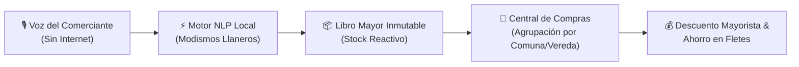

# ORIGO 🌾📲

> **Inventario por voz sin internet y central de compras colectiva para las MiPymes de Casanare**  
> Proyecto desarrollado por el equipo **NexoTECH** para la convocatoria de innovación abierta **CREATIC Casanare**  
> *Gobernación de Casanare – Dirección TIC / EON CASANARE S.A.S.*


---

## 🎯 1. El Problema en el Comercio Casanareño

En municipios y zonas rurales de Casanare (Yopal, Aguazul, Villanueva, Tauramena, Maní, etc.), la mayoría de tenderos, dueños de ferreterías, agroinsumos y pequeños restaurantes llevan sus cuentas "en la cabeza o en un cuaderno" y compran mercancía de manera solitaria.

Esto genera tres pérdidas críticas diarias:
1. **Productos perdidos o agotados sin saberlo:** Falta de trazabilidad y desabastecimiento imprevisto.
2. **Precios altos de compra y fletes individuales:** Al negociar en bajo volumen frente a molinos y distribuidores, pagan precio minorista y asumen altos costos de transporte.
3. **Abandono tecnológico:** El software tradicional exige internet permanente (que falla frecuentemente en la región), digitación en formularios pequeños y habilidades digitales avanzadas.

---

## 💡 2. La Solución: Origo

**Origo** integra los dos procesos clave de la cadena de valor en una solución accesible y de alto impacto:



### Pilares de la Solución:
* **Inventario por Voz 100% Offline:** El comerciante simplemente presiona un botón y dicta con su vocabulario habitual:  
  * *"Llegaron 20 bultos de arroz y 5 de sal"*  
  * *"Vendí 3 arrobas de papa y 2 pacas de panela"*  
  La aplicación transcribe en el propio celular, extrae la intención, cantidad, unidad de medida local y nombre del producto, mostrando una pantalla de confirmación rápida antes de guardar.
* **Central de Compras Colectiva:** Al registrar el movimiento real, la aplicación detecta cuándo el producto está por agotarse y propone el pedido de reposición. Agrupa la demanda de comercios vecinos de la misma zona para negociar con distribuidores a precios mayoristas y compartir el costo del flete.

---

## 🏛️ 3. Arquitectura del Proyecto

El repositorio está organizado bajo una estructura modular orientada a desacoplamiento y escalabilidad:

```text
MyPymes/
├── core_nlp/                     # Motor NLP heurístico local (cero dependencias)
│   ├── catalog.json              # Catálogo tipificado con unidades regionales de Casanare
│   ├── parser.py                 # Normalización léxica, extracción de entidades y fuzzy matching
│   └── test_parser.py            # Suite de pruebas unitarias de interpretación lingüística
├── backend/                      # Backend API REST en Rust (Tokio + Axum + SQLite/PostgreSQL-ready)
│   ├── Cargo.toml                # Manifiesto del crate origo-backend (binario origo-server)
│   ├── schema_postgres.sql       # Esquema central PostgreSQL 16+ (tablas, vistas e índices)
│   ├── src/
│   │   ├── main.rs               # Servidor HTTP Axum y despacho de archivos estáticos
│   │   ├── lib.rs                # Exportación de módulos del dominio
│   │   ├── models.rs             # Contratos y modelos de dominio (Event Sourcing + DTOs)
│   │   ├── nlp.rs                # Motor NLP heurístico regional en Rust (modismos de Casanare)
│   │   ├── auth.rs               # Autenticación PBKDF2-SHA256 + PIN móvil y Ley 1581 de 2012
│   │   ├── ledger.rs             # Libro mayor inmutable SQLite y corte diario (00:00–23:59)
│   │   ├── collective.rs         # Motor de central de compras colectivas
│   │   └── routes.rs             # Endpoints REST + sincronización offline idempotente + pruebas E2E
│   └── static/                   # Interfaz web modularizada
│       ├── index.html            # Estructura semántica limpia
│       ├── css/styles.css        # Sistema de diseño accesible (WCAG AAA)
│       └── js/                   # Módulos: api.js, auth.js, voice.js, inventory.js, community.js, app.js
├── sync_core/                    # Núcleo de sincronización Offline-First en Rust (SQLite <-> PostgreSQL)
│   ├── Cargo.toml                # Configuración del crate (lib FFI + binario origo-sync)
│   ├── README.md                 # Guía de despliegue del núcleo de sincronización
│   └── src/                      # Módulos: config, models, local_store, remote_pg, sync_engine, lib, main
├── mobile/                       # Cliente móvil multiplataforma modular (Flutter / Dart + Vosk Offline)
│   ├── lib/
│   │   ├── main.dart             # Orquestador principal y navegación
│   │   ├── models/               # Modelos: merchant_profile, product_stock, movement_log
│   │   ├── services/             # Servicios: nlp_service, offline_ledger, offline_voice_service, sync_service
│   │   ├── screens/              # Pantallas: login, home, inventory, community
│   │   └── widgets/              # Componentes: origo_header, product_card, confirmation_sheet
│   ├── assets/catalog.json       # Catálogo regional offline
│   └── pubspec.yaml              # Configuración Flutter
├── docs/                         # Documentación técnica, arquitectura Rust/PG y guion de presentación
├── .gitignore                    # Reglas de exclusión del entorno
└── README.md                     # Documento técnico principal
```

---

## ⚡ 4. Guía de Ejecución y Validación Técnica

El backend principal de **Origo** está implementado en **Rust (Tokio + Axum + rusqlite)** para ofrecer alto rendimiento, seguridad de memoria y consumo mínimo de recursos, manteniendo 100% compatibilidad con la app móvil Android (Flutter + Vosk offline) y la consola web.

### 4.1. Suite de Pruebas Unitarias e Integración E2E (Rust):
Valida el motor NLP casanareño, la seguridad PBKDF2 + Ley 1581, el corte diario `00:00–23:59`, las compras colectivas y el aislamiento multi-tienda de sincronización offline:
```bash
cd backend && cargo test
```

### 4.2. Inicialización del Servidor REST y Consola Web (Rust):
Compila e inicia el servidor de alto rendimiento (escucha en `0.0.0.0:8000` para aceptar conexiones locales y de celulares en la red Wi-Fi):
```bash
cd backend && cargo run --release
```
Acceso a la consola operativa en: `http://localhost:8000` (health check en `http://localhost:8000/api/health`).

### 4.3. Verificación Independiente del Catálogo NLP (Opcional - Python):
```bash
python3 core_nlp/test_parser.py
```

---

## 🛡️ 5. Cumplimiento Normativo y Seguridad
* **Protección de Datos Personales:** Cumple estrictamente con la **Ley 1581 de 2012** (Habeas Data Colombia), minimizando la recolección de datos personales de clientes finales.
* **Ciberseguridad:** Transacciones inmutables mediante UUIDs v4 (*Event Sourcing*) para evitar inconsistencias en sincronización fuera de línea y cifrado en reposo y en tránsito.
