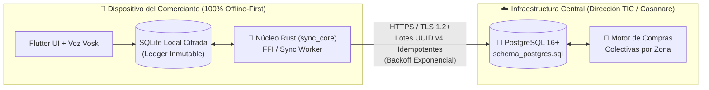

# Arquitectura de Sincronización Offline-First: SQLite ↔ Núcleo Rust ↔ PostgreSQL

**Proyecto:** Origo (Equipo NexoTECH · CREATIC Casanare)  
**Capítulos cubiertos del Anteproyecto:** 4.3 (Modo Offline), 4.4 (Ciberseguridad), 4.5 (Ley 1581 de 2012) y Escalabilidad Modular.

---

## 1. Visión General de la Arquitectura

Origo separa completamente la **captura operativa en campo** (que debe responder en milisegundos sin internet) de la **consolidación departamental** (donde miles de MiPymes de Casanare agregan demanda para compras colectivas):



---

## 2. Por qué un Núcleo en Rust (`sync_core/`)

1. **Rendimiento y seguridad de memoria sin *garbage collector*:** Ideal para ejecutarse en segundo plano en celulares Android de gama media/baja en zonas rurales consumiendo mínima batería.
2. **Idempotencia garantizada:** Cada movimiento nace con un **UUID v4** único en SQLite (`synced = 0`). Al sincronizar, Rust ejecuta una transacción atómica en PostgreSQL con:
   ```sql
   INSERT INTO inventory_movements (...) VALUES (...)
   ON CONFLICT (id) DO NOTHING;
   ```
   Si la señal 4G cae a mitad del envío, reintentar el lote jamás duplica ni corrompe el inventario.
3. **Revocación remota ante pérdida o robo:** Antes de aceptar un lote, `sync_core` verifica en `device_sessions` que `revoked = FALSE`. Si un dispositivo fue reportado como robado, la sincronización se bloquea de inmediato.
4. **Reutilización multiplataforma:** El mismo crate Rust (`sync_core`) puede correr como **biblioteca embebida en Flutter vía FFI (`flutter_rust_bridge`)** o como **servicio/daemon sincronizador** en un servidor local.

---

## 3. Modelo de Autenticación Híbrida (Online + Offline)

| Fase | Red | Autoridad | Qué ocurre |
| :--- | :--- | :--- | :--- |
| **1. Registro / Primer Login** | 🌐 Online | PostgreSQL | Valida celular + PIN (`Argon2id`/`PBKDF2 + sal`), registra consentimiento **Ley 1581 de 2012** y crea `device_sessions`. |
| **2. Desbloqueo diario** | ✈️ Offline | Rust + SQLite | Verifica el PIN contra el hash local en tiempo constante y desbloquea la base SQLite local (cero internet). |
| **3. Sincronización** | 🌐 Reconexión | Rust → PostgreSQL | Valida que `device_id` no esté revocado, sube lotes `synced = 0`, marca `synced = 1` y actualiza compras colectivas. |

---

## 4. Regla de Aislamiento de Datos (Ley 1581 de 2012)

* El celular **nunca** descarga la tabla `users` completa de PostgreSQL ni información de otros comercios.
* La consolidación de la **Central de Compras Colectivas** solo comparte volúmenes agregados por zona (`v_daily_inventory`, `collective_orders`), preservando la privacidad comercial de cada MiPyme.
