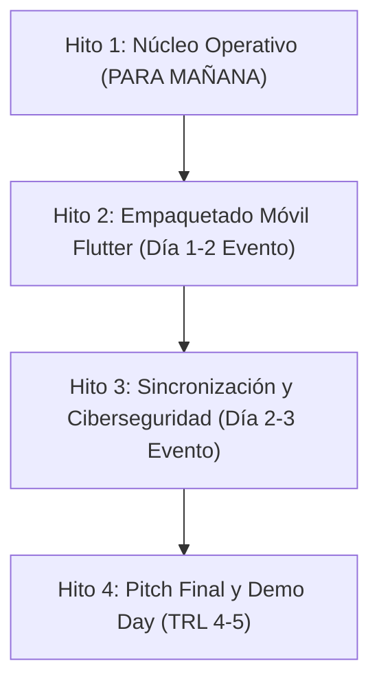

# Plan Estratégico y Técnico de Desarrollo: NexoLlano 🌾📲
**Convocatoria de Innovación Abierta CREATIC Casanare**  
*Gobernación de Casanare – Dirección TIC / EON CASANARE S.A.S.*  
**Nivel de Madurez Tecnológica Objetivo:** TRL 4-5 (Prototipo funcional validado en entorno demostrable)

---

## 🎯 1. Objetivo Crítico y Prioridad para MAÑANA

El evento/presentación es **mañana**. Los evaluadores de CREATIC Casanare califican:
1. **Impacto Socioeconómico y Pertinencia Local:** Resolver problemas reales del tendero y productor casanareño.
2. **Innovación y Viabilidad Técnica:** Demostrar que funciona de verdad (no maquetas estáticas de Figma).
3. **Escalabilidad y Sostenibilidad:** Cómo se sostiene económicamente y cómo genera efecto de red.

> [!IMPORTANT]
> **La Prueba de Oro para el Pitch:**
> Demostrar en vivo el **"Flujo Modo Avión"**: dictar una entrada/salida de inventario con modismos de Casanare sin internet, ver el cálculo automático del stock inmutable, activar la señal, ver la sincronización y mostrar cómo se agrupa la compra con 3 tiendas vecinas de Yopal/Aguazul generando un ahorro mayorista tangible en pesos (\$ COP).

---

## 🗓️ 2. Fases de Ejecución

---

### 🟢 HITO 1 (URGENTE: PARA MAÑANA - Base Demostrable en Vivo)
*Meta: Tener el motor lógico, catálogo llanero, simulación visual y guion de presentación 100% operativos.*

- [ ] **1.1 Repositorio y Arquitectura Limpia:**
  - Inicializar Git con branch `main` y `.gitignore` profesional.
  - Estructura modular: `docs/`, `core_nlp/`, `backend/`, `mobile/`.
  - `README.md` ejecutivo de alto impacto institucional.

- [ ] **1.2 Catálogo Regional Casanareño & Motor de Voz Heurístico (`core_nlp/`):**
  - **Unidades locales:** bultos, arrobas, cargas, pacas, canastillas, galones, cajas, kilos, unidades.
  - **Productos insignia:** Arroz Casanareño, Harina Pan, Aceite vegetal, Panela criolla, Abono Triple 15, Cemento gris, Sal marina, Azúcar blanca.
  - **Parser de voz a entidades estructuradas:** Extracción de `{acción, cantidad, unidad, producto}`.
  - **Fuzzy Matching:** Detección tolerante a ruido o variaciones fonéticas ("arrosito", "arroba e papa").
  - Pruebas unitarias automatizadas garantizando >95% de precisión en modismos.

- [ ] **1.3 Motor de Inventario Offline Inmutable (`Ledger`):**
  - Modelo *Event Sourcing*: cada transacción es un evento inmutable con UUID, timestamp y estado de sincronización.
  - Cálculo reactivo del stock: $\text{Stock} = \sum(\text{Entradas}) - \sum(\text{Salidas})$.
  - Cero inconsistencias al operar desconectado.

- [ ] **1.4 Simulador Interactivo Demostrable para Mañana:**
  - Panel visual web/consola de respuesta inmediata que permita en la presentación:
    1. Dictar o escribir frases reales en vivo.
    2. Ver la tarjeta de confirmación de datos.
    3. Simular corte de red (Modo Offline).
    4. Simular 3 tiendas de la misma comuna en Yopal y ver cómo la compra colectiva ahorra flete y precio mayorista con cifras reales en pantalla.

- [ ] **1.5 Guion y Tarjetas del Pitch:**
  - Discurso ensayado de 4 minutos con estructura de impacto (Problema -> Solución -> Demo Modo Avión -> Ahorro Económico -> Sostenibilidad y Habeas Data).

---

### 🟡 HITO 2 (DÍAS 1 Y 2 DEL EVENTO: Experiencia Móvil Flutter)
*Meta: Interfaz nativa en el celular con alta accesibilidad para comerciantes mayores o con baja escolaridad.*

- [ ] **2.1 Configuración de Flutter (Android 12+ / iOS 16+):**
  - UI de alta legibilidad (contrastes altos, tipografía grande, botón de dictado prominente tipo PTT).
- [ ] **2.2 Reconocimiento de Voz On-Device (Speech-to-Text Offline):**
  - Integración de reconocedor local sin consumo de megas ni latencia de red.
- [ ] **2.3 Pantalla de Confirmación Anti-Errores:**
  - Visualización inmediata de lo reconocido con botones táctiles de ajuste rápido (+ / -) antes de asentar en el inventario.
- [ ] **2.4 Alertas de Reposición y Sugerencia de Pedido:**
  - Indicadores semáforo (Verde / Amarillo / Rojo crítico) cuando el inventario baja del umbral mínimo.

---

### 🟠 HITO 3 (DÍAS 2 Y 3: Backend de Central de Compras y Sincronización)
*Meta: Demostrar el segundo pilar de valor (el poder de compra de la red).*

- [ ] **3.1 API REST Ligera (FastAPI):**
  - Endpoint `/api/sync/movements`: recepción idempotente de lotes de movimientos pendientes.
  - Endpoint `/api/collective-orders/aggregate`: algoritmo que agrupa pedidos por geolocalización (ej. Comuna 2 Yopal o Aguazul) y aplica la tabla de descuento de molinos/distribuidores aliados.
- [ ] **3.2 Ciberseguridad y Cumplimiento Legal (Capítulo 4.4 y 4.5):**
  - Almacenamiento local cifrado (SQLite/SQLCipher).
  - Tráfico protegido con TLS 1.2+ / HTTPS.
  - Política de privacidad y minimización de datos conforme a la **Ley 1581 de 2012** (Habeas Data Colombia).

---

### 🔴 HITO 4 (CIERRE Y PITCH DE EVALUACIÓN - TRL 4-5)
- [ ] Ensayo del flujo completo bajo Modo Avión frente al jurado.
- [ ] Métricas de validación: tiempo de registro (reducción de 3 minutos en papel a 8 segundos por voz) y ahorro promedio proyectado del 15% al 22% en compras colectivas.

---

## 🚫 Reglas para NO desviarnos del proyecto:
1. **No agregar pasarelas de pago bancarias complejas durante el evento:** La compra colectiva en esta fase consolida el pedido y el ahorro; el pago y despacho se gestiona con el distribuidor/molino.
2. **No depender de APIs de voz en la nube para el flujo principal:** Toda la demo debe funcionar desconectada.
3. **Mantener el vocabulario adaptado al Llano:** Usar siempre los términos regionales del comercio casanareño.
